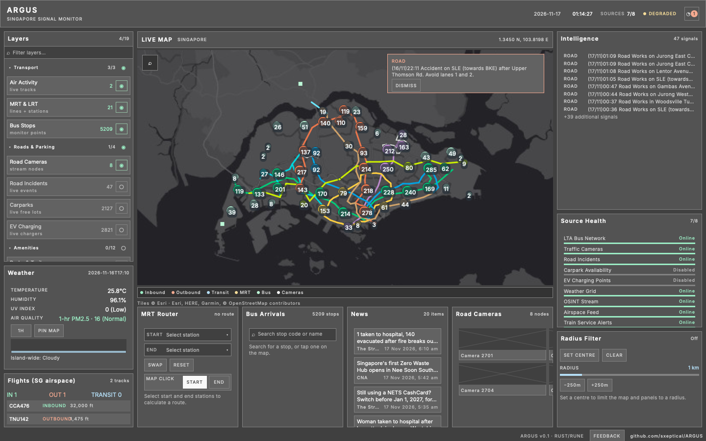

# ARGUS

Singapore OSINT command center — a **native desktop app** built in Rust on the
[Rune](https://github.com/anomalyco/rune) UI framework. Live transport,
aviation, weather, cameras and news on one tactical map, with all API calls made
directly from Rust. No browser, no Workers, no server-side proxy.



---

## What it does

- **Custom dark map** of Singapore (Esri World Dark Gray raster tiles, optional
  CARTO key) with drag-to-pan, wheel/pinch zoom, and overlaid sensors.
- **Toggleable sensor layers**: flights (heading-aware markers), traffic
  cameras, bus stops, MRT lines/stations, roads/incidents, carparks and EV
  chargers, parks / park connectors / trails, and a dozen static amenity
  datasets (hawkers, malls, gyms, schools, healthcare, heritage, hotels,
  libraries, pharmacies, community clubs, supermarkets).
- **Live feeds** (via `argus-data`): LTA bus stops/arrivals, cameras, incidents,
  carparks, EV chargers and train alerts; data.gov.sg weather/PSI/PM2.5;
  AviationStack flights with OpenSky fallback and last-good snapshot; ST/CNA
  RSS news. Per-source health is shown in the Intel panel.
- **Transit tools**: MRT route planner (Dijkstra over the station graph), bus
  stop search with live arrivals and route geometry.
- **Intel panel**: signals digest combining rail disruption, road incidents and
  unhealthy PSI into in-app toasts, plus radius geo-filtering of map markers.
- **Amenity details**: focus dialogs with photos, opening hours, closure dates,
  and (for malls) a filterable store directory grouped by floor.
- **Resilience**: per-key TTL cache with in-flight dedup and negative caching;
  partial/per-feed failures never blank the dashboard; flight fallback chain
  AviationStack → OpenSky → last good.

Data credits: LTA DataMall, data.gov.sg (Singapore Open Data Licence), NParks,
AviationStack, OpenSky, OpenStreetMap contributors (ODbL), Wikimedia Commons,
NEA, HSA, NLB, NHB, MOE, PA, SportSG, and
[curioputterings/singapore-mall-data](https://github.com/curioputterings/singapore-mall-data)
(CC BY 4.0). Each source is credited in the UI where its data appears.

---

## Requirements

- **Rust 1.99.1** — pinned in `rust-toolchain.toml`; `rustup` picks it up
  automatically. Install with
  `rustup toolchain install 1.99.1 --profile minimal --component clippy,rustfmt`.
- **Edition 2024**, Cargo resolver 3. `clippy` and `rustfmt` are needed for CI.
- **Platforms**: macOS, Windows and Linux (Rune's supported native targets).
  A GPU (or a software adapter) is needed for the window; headless rendering
  works without a display.
  - On Debian/Ubuntu, install Rune's keyboard dependency:
    `sudo apt-get install -y libxkbcommon-dev libxkbcommon0`.
- Rune is a git dependency pinned to a dev rev; the first build fetches it and
  repeats the five `[patch.crates-io]` entries declared in `Cargo.toml`. Keep
  all six revs in sync when upgrading (see `docs/ARCHITECTURE.md`).

---

## Configuration

Copy `.env.example` to `.env` in the working directory and fill in the keys you
need. Process environment variables take precedence over `.env`; an optional
`~/.config/argus/config.toml` (or `ARGUS_CONFIG_FILE`) is the lowest-precedence
source. Missing or placeholder keys simply mark that feed "unconfigured" — the
app still runs with the remaining sources.

| Variable | Purpose |
| --- | --- |
| `LTA_API_KEY` | LTA DataMall: buses, cameras, incidents, carparks, EV, train alerts |
| `AVIATIONSTACK_API_KEY` | Primary flight feed (falls back to keyless OpenSky) |
| `DATABASE_URL` | Optional Neon Postgres string for the feedback form; create the table with `psql "$DATABASE_URL" -f scripts/sql/feedback.sql` |
| `ARGUS_DATA_DIR` | Static JSON bundle directory (default: `<repo>/data`) |
| `ARGUS_CONFIG_FILE` | Override for the optional TOML config path |
| `ARGUS_CONFIG_DIR` | Override for saved UI preferences (default `~/.config/argus`) |
| `ARGUS_CACHE_DIR` | Override for the map tile disk cache |
| `ARGUS_CARTO_KEY` | Optional key for CARTO dark basemap tiles (Esri is keyless) |

**Never commit `.env` or real keys** — `.env*` is gitignored, except
`.env.example`.

---

## Build and run

```sh
cargo run -p argus-app --release          # launch the desktop window
cargo build --workspace                   # build everything
cargo test --workspace                    # unit + integration tests (live tests ignored)
cargo fmt --all -- --check
cargo clippy --workspace --all-targets -- -D warnings
```

### Headless scenes and snaps

Rune renders every app headlessly with the same renderer. Release builds keep
the tooling because `argus-app` enables Rune's `tooling` feature.

```sh
cargo run -p argus-app -- --list-scenes
cargo run -p argus-app -- --snap docs/snaps/dashboard.png --scene dashboard
cargo run -p argus-app -- --tree out/tree.json --scene panels
```

Common flags: `--snap out.png [--scene NAME] [--at T] [--size WxH] [--scale N]
[--theme dark|light]`, `--tree out.json`, `--script script.json`,
`--list-scenes`. `--snap` writes at 2× scale by default. Available scenes
include `dashboard`, `layers-on`, `route-planner`, `poi-dialog`,
`mall-directory`, `photo-gallery`, `hover-popup`, `panels`, `live`, `cameras`,
`camera-dialog` and `loading`. Checked-in renders live in `docs/snaps/`; the
`live` scene preloads real network data, the others use deterministic fixtures.

### Live smoke tests

The network-dependent tests are `#[ignore]` by default so CI stays offline:

```sh
cargo test -p argus-data --test live_smoke -- --ignored --nocapture --test-threads=1
```

---

## Static data and regeneration

The JSON bundles the app loads are checked in under `data/` (loaded via
`argus-core::data::DataDir`; override with `ARGUS_DATA_DIR`). The `scripts/`
directory holds Node `.mjs` authoring pipelines that rebuild them from public
sources. They use only Node built-ins — no `node_modules` or `package.json` is
needed — but **require network access** and write into `data/`:

```sh
node scripts/fetch-amenities.mjs
node scripts/fetch-hawker-closures.mjs   # after fetch-amenities
node scripts/fetch-parks.mjs
node scripts/fetch-park-photos.mjs
node scripts/fetch-gyms.mjs
# ...and the other fetch-*.mjs scripts
node scripts/apply-photo-picks.mjs       # reapply reviewed picks without refetching
```

Upstream/download failures are reported per script (HTTP errors mean an
upstream URL or dataset id needs refreshing); the checked-in bundles are
committed so the app works without running these. The reviewed photo picks live
in `scripts/data/photo-picks.json`, and the feedback SQL table is in
`scripts/sql/feedback.sql`.

---

## Architecture

Workspace crates (see `docs/ARCHITECTURE.md` for the full notes, module map and
Rune API reference):

- **`argus-core`** — domain types, pure logic, bundle validators and the
  `DataDir`/`StaticData` loaders. No UI and no network dependencies.
- **`argus-data`** — `reqwest::blocking` clients per upstream, TTL cache,
  config/keys, feedback and source health. Depends on `argus-core`, never Rune.
- **`argus-map`** — Mercator camera, raster tile store, overlays/hit-testing and
  the Rune `map_view`. Defines its own small view types; no `argus-core` dep.
- **`argus-app`** — the `argus` binary: `AppSpec` wiring, state/reducers,
  feed polling through Rune `Latest`, panels, dialogs and headless scenes.

Dependency direction: `argus-app → {argus-core, argus-data, argus-map, rune}`;
`argus-data → argus-core`; `argus-map` is independent of the other two crates.

---

## License

MIT — see [LICENSE](LICENSE). Rune is MIT, © Anomaly.
